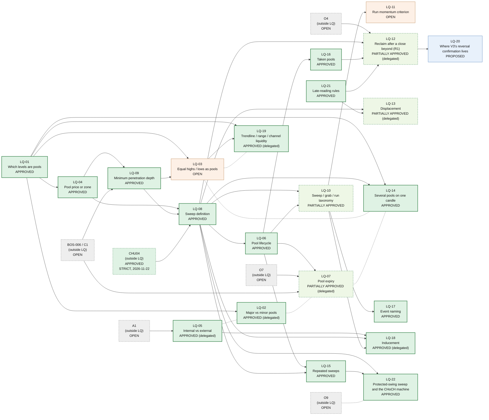

# LQ dependency map and decision order

**Decision register.** Owner decisions of **2026-11-22** and delegated MVP decisions are recorded here; the source documents in `research/v6/specs/liquidity_sweep/` are unchanged.

- **LQ decisions (LQ-01…LQ-22):** 15 APPROVED, 4 PARTIALLY APPROVED, 1 PROPOSED, 2 OPEN; of these, 4 APPROVED and 3 PARTIALLY APPROVED by delegated decision (2026-11-23).
- **External owner decisions (outside LQ):** 1 APPROVED (CHU04). Counted separately, never added to the LQ counts.

Status values:
- **APPROVED:** explicit owner decision, recorded verbatim with its date.
- **OWNER APPROVED — DELEGATED DECISION:** an APPROVED or PARTIALLY APPROVED decision finalized under the owner's
  delegated authority for the initial PAPER-ONLY MVP; documented, not implemented (marked per decision).
- **PARTIALLY APPROVED:** part of the decision is approved (stated verbatim); the remaining part is named and stays OPEN.
- **PROPOSED:** B0 has a concrete proposal; not approved.
- **OPEN:** no concrete proposal, or B0 is a placeholder, "not modelled" or "excluded"; not approved.

Question, B0 proposal and alternatives are copied **verbatim** from `UNRESOLVED_DECISIONS.md` (checked by the generator:
22 / 22 rows match). **No liquidity detector is implemented** (see "Technical implementation not yet verified").

A solid arrow **A → B** means: decide A before B (B's options are defined in terms of A). A dashed line means the two
decisions overlap or interact without a strict order. Node colours: green = APPROVED, light green dashed = PARTIALLY
APPROVED, blue = PROPOSED, orange = OPEN; grey dashed = open item outside the liquidity spec, green dashed = approved item
outside it (CHU04). Rendered: `lq_dependency_map.png`; source: `lq_dependency_map.mmd`.

## Dependency table

| Decision | Status | Depends on | Blocks |
|---|---|---|---|
| LQ-01 | APPROVED | – | LQ-02, LQ-03, LQ-04, LQ-14, LQ-19 |
| LQ-02 | APPROVED | LQ-01 (APPROVED) | – |
| LQ-03 | OPEN | LQ-01 (APPROVED), LQ-09 (APPROVED) | LQ-19 |
| LQ-04 | APPROVED | LQ-01 (APPROVED) | LQ-08, LQ-09 |
| LQ-05 | APPROVED | A1 (OPEN, external) | LQ-18 |
| LQ-06 | APPROVED | LQ-08 (APPROVED) | LQ-07, LQ-10, LQ-15, LQ-16 |
| LQ-07 | PARTIALLY APPROVED | LQ-06 (APPROVED), O7 (OPEN, external), BOS-006 / C1 (OPEN, external) | – |
| LQ-08 | APPROVED | LQ-04 (APPROVED), LQ-09 (APPROVED), CHU04 (APPROVED, external) | LQ-06, LQ-10, LQ-12, LQ-13, LQ-14, LQ-15, LQ-18, LQ-22 |
| LQ-09 | APPROVED | LQ-04 (APPROVED), BOS-006 / C1 (OPEN, external) | LQ-03, LQ-08 |
| LQ-10 | PARTIALLY APPROVED | LQ-08 (APPROVED), LQ-06 (APPROVED) | LQ-11, LQ-17, LQ-18 |
| LQ-11 | OPEN | LQ-10 (PARTIALLY APPROVED) | – |
| LQ-12 | PARTIALLY APPROVED | O4 (OPEN, external), LQ-08 (APPROVED), LQ-16 (APPROVED), LQ-21 (APPROVED) | LQ-20 |
| LQ-13 | PARTIALLY APPROVED | LQ-08 (APPROVED), LQ-21 (APPROVED) | – |
| LQ-14 | APPROVED | LQ-01 (APPROVED), LQ-08 (APPROVED) | – |
| LQ-15 | APPROVED | LQ-06 (APPROVED), LQ-08 (APPROVED) | LQ-22 |
| LQ-16 | APPROVED | LQ-06 (APPROVED) | LQ-12 |
| LQ-17 | APPROVED | LQ-10 (PARTIALLY APPROVED) | – |
| LQ-18 | APPROVED | LQ-05 (APPROVED), LQ-08 (APPROVED), LQ-10 (PARTIALLY APPROVED) | – |
| LQ-19 | APPROVED | LQ-01 (APPROVED), LQ-03 (OPEN) | – |
| LQ-20 | PROPOSED | LQ-12 (PARTIALLY APPROVED) | – |
| LQ-21 | APPROVED | – | LQ-12, LQ-13 |
| LQ-22 | APPROVED | LQ-08 (APPROVED), LQ-15 (APPROVED) | – |

## Overlaps / interactions (dashed; no strict order)

| Pair | Nature |
|---|---|
| LQ-05 – LQ-02 | 'major' might mean 'external' |
| LQ-02 – LQ-07 | an age filter (LQ-02) is also an expiry (LQ-07) |
| LQ-03 – LQ-14 | EQ / similar-price pools multiply same-candle events |
| LQ-07 – LQ-14 | no expiry multiplies same-candle events (LP §C) |
| LQ-03 – LQ-19 | '≥ 2 swings in a band' vs 'repeated S/R' |
| O9 – LQ-22 | a pool TAKEN before the structure establishes, while the CHoCH layer still treats the level as protected (reporting settled by G-11; O9 itself OPEN) |

## Decision order

Derived from the dependency edges: a decision is placed after everything it depends on. Tiers 0–3 hold the decisions a
minimal B0 detector needs; tiers 4–5 hold the remaining PROPOSED / OPEN decisions, in the order they can be taken.

**Tier 0 - items outside LQ that LQ decisions depend on:** CHU04 (APPROVED external owner decision, STRICT, 2026-11-22), O4 (OPEN; with LQ-12), BOS-006 / C1 (OPEN; LQ-09 precision, LQ-07 gaps; B0 uses raw float meanwhile, G-8), O7 (OPEN; LQ-07 sessions), A1 (OPEN; LQ-05, LQ-18)

**Tier 1 - foundations: APPROVED 2026-11-22:** LQ-01, LQ-04, LQ-21

**Tier 2 - the sweep test: APPROVED 2026-11-22:** LQ-09, LQ-08 (including the close == P sub-case)

**Tier 3 - lifecycle and events: APPROVED 2026-11-22 (LQ-10 partially):** LQ-06, LQ-16, LQ-15, LQ-14, LQ-22, LQ-10 (B0 scope approved; GRAB / RUN taxonomy OPEN), LQ-17, LS-S02 / LS-S09 / LS-S11 / LP-12 pool part (APPROVED)

**Tier 4 - refinements (statuses as in the table; several decided for the MVP on 2026-11-23):** LQ-13, LQ-02, LQ-07, LQ-03, LQ-11

**Tier 5 - composite / external / strategy (statuses as in the table):** LQ-12 (with O4), LQ-20, LQ-05 (after A1), LQ-18, LQ-19

**Status of the minimal B0 decision set (tiers 1–3):** owner-approved on 2026-11-22 (LQ-10 for its B0 scope only). Still open
outside LQ: O4, BOS-006 / C1 (B0 uses raw float meanwhile, G-8), O7, A1. **No detector is implemented**; implementation
needs separate owner authorization. Test-case status: LT-10 (close == P) is decided in this register (LQ-08 sub-case +
CHU04), although the source TEST_CASE_CATALOG still says UNSCORED. EQ pools (LT-07 / LT-08), expiry (LT-13) and reclaim
(LT-11) still depend on open decisions.

**Cycle check:** the edge set was checked for cycles by the generator: none.
