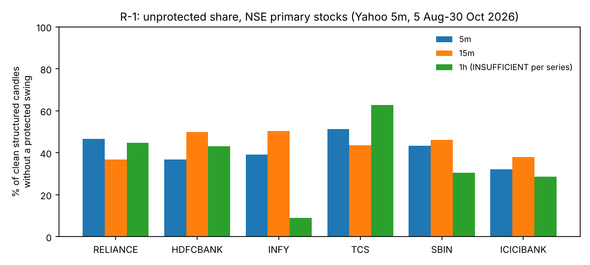
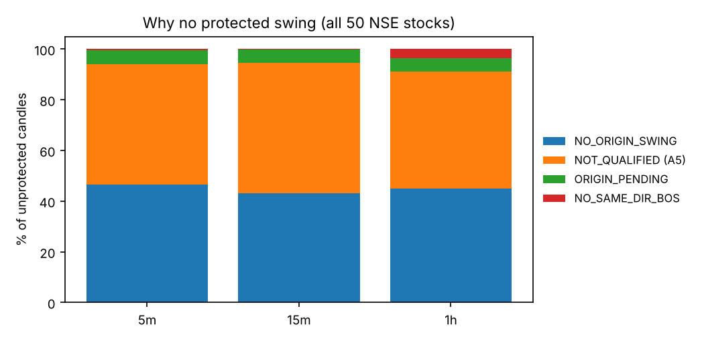
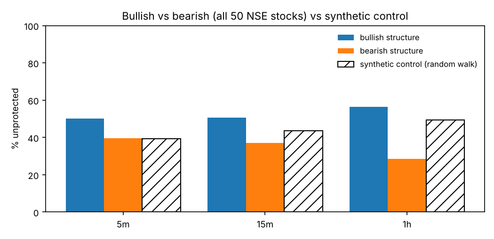
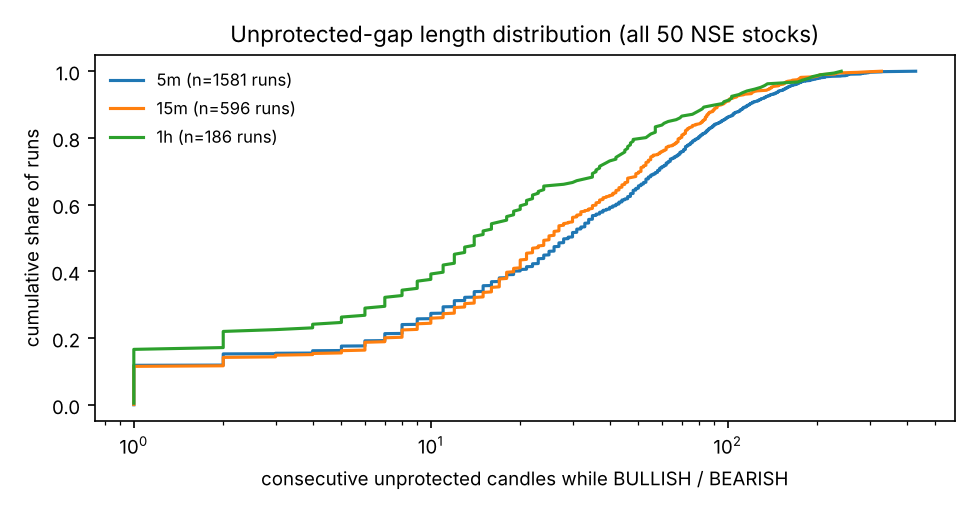

# R-1: protected-swing availability on real market data (evaluation report)

Prepared 22 Nov 2026 (Phase 3). Research only.

- Baseline: the approved V6 implementation in the worktree, used **unchanged**: `StructureStream` driven candle by
  candle.
- Plan: `R1_REAL_MARKET_EVALUATION_PLAN.md`.
- No profitability, predictive-power or trading-edge claim is made or implied.

## 0. Status: PARTIAL EVALUATION, NSE equities only

| Requested | Result |
|---|---|
| NSE 6 large caps (RELIANCE, HDFCBANK, INFY, TCS, SBIN, ICICIBANK) | **Evaluated:** 5m, 15m, 1h. 1D evaluated but **INSUFFICIENT DATA**. |
| NSE NIFTY 50, NIFTY BANK | **UNAVAILABLE** |
| Crypto BTC, ETH, SOL, XRP (Coinbase), all timeframes | **UNAVAILABLE** |
| US SPY, QQQ + 6 large caps (Alpaca IEX), all timeframes | **UNAVAILABLE** |
| Extra (not requested; labelled **EXTENDED**, reported separately, never substituted) | 44 more NSE stocks from the same cache, same method |

**Why the rest is unavailable** (nothing was fabricated or silently substituted):
- From this workspace, every market-data host is refused by the network allowlist (curl HTTP 000):
  `api.exchange.coinbase.com`, `query1.finance.yahoo.com`, `stooq.com`, `api.kraken.com`, `data.binance.vision`,
  `archives.nseindia.com`.
- The linked computer / VPS (which can reach Coinbase) is **not connected** to this session.
- Zerodha and Alpaca need broker credentials, which this task excludes.
- The only real OHLC available is the bot's own research cache in the user uploads:
  `trader/research/cache/*.NS_5m.json`, 50 NSE stocks, **no indices, crypto or US**.

**How to complete it:** run the same scripts (§9) on the VPS for Coinbase public candles, or attach CSV / JSON files for
the missing instruments. Their absence means nothing about those markets: **no conclusion here applies to crypto, US
or indices.**

## 1. Data-source manifest

| Field | Value |
|---|---|
| Source | Yahoo Finance chart API v8 (`/v8/finance/chart/<SYM>.NS?range=60d&interval=5m&includePrePost=false`), fetched by the bot's `research.py` → `scan_nse.yahoo_chart` |
| Files | `/mnt/user-data/uploads/trader/trader/research/cache/<SYM>.NS_5m.json`. Raw data stay **outside the repo**, read-only. SHA-256 for each file in `R1_artifacts/r1_data_manifest.csv`. |
| Retrieval date | not recorded by the bot. Inferred from `meta.regularMarketTime` = **2026-10-30 09:58 UTC** (15:28 IST), the last session in the files. The files were uploaded to this workspace on 2026-11-14. |
| Coverage | **2026-08-05 09:15 IST → 2026-10-30 15:25 IST**, 60 trading sessions (calendar = union of sessions present in any of the 50 files) |
| Timezone | raw: UTC epoch seconds. Sessions evaluated in Asia/Kolkata (IST). Every 5m bar was verified on the 09:15 + 5k IST grid (0 off-grid bars). |
| Adjustment | **none.** Intraday raw prices. Checked: no overnight gap > 10 % in any file, so no obvious unadjusted corporate action. |
| Pre-processing by the bot | bars with any null O / H / L / C were **dropped** at fetch time, so they appear as missing bars. Volume nulls became 0. |
| Labels | every file's `meta.symbol` equals its filename (50 / 50) |

**Raw QC** (`R1_artifacts/r1_raw_qc.csv`), all 50 files:
- 0 null OHLC;
- 0 duplicate timestamps;
- 0 out-of-order bars;
- 0 OHLC-inconsistent bars (low ≤ min(open, close), high ≥ max(open, close), low > 0);
- 0 off-grid bars.

**Missing bars** (`r1_data_quality.csv`). Of 225 000 expected 5m slots, 6 083 are missing (2.7 %). The pattern is
systematic, a source artefact rather than random loss:
- **15:20 IST** is missing in every file on every day (3 000);
- **15:25** is missing 2 305 times;
- **15:15** is missing 678 times;
- **11:45 and 11:50 on 2026-10-15** are missing in all 50 files.

Consequences:
- Every 15m and 1h bar that ends the session is incomplete.
- **Every 1D bar is incomplete** (it lacks the last 5–15 minutes), so 1D is flagged DATA_QUALITY throughout.

**Per-series quality, primary sample.** Every one of these series spans 60 / 60 sessions and has no overnight gap
> 10 %.

| Instrument | 5m candles / 4 500 | 15m / 1 500 (incomplete) | 1h / 420 (incomplete) | 1D |
|---|---|---|---|---|
| RELIANCE | 4 386 (97.5 %) | 1 495 (56) | 415 (56) | 60 (all incomplete) |
| HDFCBANK | 4 384 (97.4 %) | 1 497 (58) | 417 (58) | 60 |
| INFY | 4 380 (97.3 %) | 1 491 (52) | 411 (52) | 60 |
| TCS | 4 375 (97.2 %) | 1 487 (48) | 407 (48) | 60 |
| SBIN | 4 384 (97.4 %) | 1 496 (57) | 416 (57) | 60 |
| ICICIBANK | 4 373 (97.2 %) | 1 486 (47) | 406 (47) | 60 |

15m and 1h are **derived** from 5m by session-anchored resampling (09:15 IST):
- 15m: 25 bars / day.
- 1h: 7 bars / day; the last bar (15:15–15:30) is 15 min by construction.
- 1D: 1 bar / day.

A resampled bar is marked incomplete if any 5m constituent is missing. No bar is ever created where no data exist.

## 2. Definitions (all fixed before running)

Every candle of an instrument × timeframe gets **exactly one bucket**, in this priority:

| Bucket | Definition |
|---|---|
| `DATA_QUALITY` | the candle is an incomplete resampled bar, **or** a missing in-session bar / missing session lies between it and the candle R = 2 bars earlier (its swing window is affected) |
| `SESSION_GAP` | the first candle of a session after the overnight / weekend / holiday break (intraday timeframes only) |
| `INSUFFICIENT_HISTORY` | state UNKNOWN and fewer than 2 confirmed swing highs or 2 confirmed swing lows (the structure cannot be established yet) |
| `TRANSITION` | state TRANSITION(bullish / bearish) |
| `UNKNOWN_STRUCTURE` | state UNKNOWN for any other reason (mixed / equal swings, CHU05 / C6) |
| `STRUCTURED` (= **S**) | state BULLISH or BEARISH, and none of the above |

**Measures:**
- **Headline:** U % = unprotected candles in S / S. A candle is "unprotected" when no protected swing is in force after
  its close (the official `timeline.protected_price` is None).
- **Secondary:**
  - U % over *all* BULLISH / BEARISH candles, including those in DATA_QUALITY / SESSION_GAP;
  - U % inside those two buckets, so the effect of the exclusion is visible.

**Cause of each unprotected candle in S.** It is attributed to the latest same-direction BOS at or after the reversal
point (`min_bos_index`):

| Cause | Meaning |
|---|---|
| `NO_ORIGIN_SWING` | that BOS had no confirmed origin swing |
| `NOT_QUALIFIED_A5` | the origin failed A5 |
| `ORIGIN_PENDING` | the origin is not yet confirmed |
| `NO_SAME_DIRECTION_BOS` | there is no such BOS yet |
| `CONSUMED` | the protected swing was consumed |

**Other metrics:**
- **Run:** consecutive unprotected candles while BULLISH / BEARISH. A run ends only at a protected candle or a state
  change. The state carries across session breaks (O7 is unresolved), so gap candles inside a run are counted and the
  session breaks a run spans are recorded.
- **Activation:** a P-B `ACTIVATED` note. The rate is per 1 000 candles and per BOS.
- **ATR distance:** |close − protected| / ATR(14) on S candles with a protected swing. ATR is a trailing mean of the
  true range over 14 bars.
- **Missed break (diagnostic, not a rule):** while unprotected, the close goes beyond the latest confirmed opposite
  swing known before the candle. Counted once per (run, swing).
- **S-1 re-selection:** a BOS leg whose origin changes to a more extreme candidate after an earlier candidate was
  evaluated.
  - *Classic:* the earlier candidate was the active protected swing and the new one fails A5.
  - *Eligible leg:* a BOS whose origin was evaluated (`ACTIVATED` or `NOT_QUALIFIED`).
- **Segments** (S candles only):
  - Session by bar-open IST: OPEN 09:15–10:00, MID 10:00–14:30, CLOSE 14:30–15:30.
  - Volatility: ATR / close tercile, with thresholds from **strictly earlier** candles of the same series (first 100 =
    WARMUP).
  - Trend: sign of the 10-bar change in SMA(50) on the **same** timeframe. This deviates from the plan's "1D 50-bar
    slope", because only 60 daily bars exist.
- **Reliability** (declared in advance): a series is **INSUFFICIENT DATA** if S < 500 or BOS < 30. S-1 is
  INSUFFICIENT if eligible legs < 30. A segment is INSUFFICIENT if S < 500.

**Pooled confidence interval:** 95 % day-block bootstrap. The (instrument, session) blocks are resampled with
replacement, 1 000 reps, because candles are autocorrelated and a binomial CI would be far too narrow.

**Synthetic control:**
- A Gaussian random walk per primary series, with the same timestamps and sessions and with the real series'
  in-session close-to-close σ and median wick, on the NSE 0.05 tick. 3 seeds per series.
- Labelled **SYNTHETIC CONTROL** and never pooled with market data.

## 3. Protected-swing availability: results

### 3.1 Headline (pooled; per-series values in `r1_summary_by_instrument_timeframe.csv`)

| Sample | TF | Series | Candles | S (clean) | **U %** | 95 % CI | U % all-structured | Reliable series |
|---|---|---|---|---|---|---|---|---|
| PRIMARY | 5m | 6 | 26 282 | 19 118 | **41.6** | 37.3–46.2 | 41.8 | 6 / 6 |
| PRIMARY | 15m | 6 | 8 952 | 6 040 | **44.0** | 38.8–49.3 | 43.9 | 6 / 6 |
| PRIMARY | 1h | 6 | 2 472 | 1 314 | 34.3 | 28.9–40.0 | 34.8 | **0 / 6: INSUFFICIENT DATA** |
| PRIMARY | 1D | 6 | 360 | 0 | – | – | (34.0) | **0 / 6: INSUFFICIENT DATA** |
| EXTENDED | 5m | 44 | 192 635 | 145 026 | 45.5 | 43.9–47.3 | 45.6 | 44 / 44 |
| EXTENDED | 15m | 44 | 65 538 | 46 022 | 44.1 | 42.1–46.1 | 44.0 | 44 / 44 |
| EXTENDED | 1h | 44 | 18 018 | 9 478 | 42.2 | 40.1–44.5 | 42.5 | 0 / 44 per series (pooled only) |
| ALL 50 | 1D | 50 | 3 000 | 0 | – | – | (31.3) | **INSUFFICIENT DATA** |

**Primary 5m per series (U %):** RELIANCE 46.6 · HDFCBANK 36.8 · INFY 39.1 · TCS 51.2 · SBIN 43.4 · ICICIBANK 32.2.

**Primary 15m per series (U %):** RELIANCE 36.7 · HDFCBANK 50.0 · INFY 50.4 · TCS 43.6 · SBIN 46.2 · ICICIBANK 38.0.

The spread between stocks (32–51 %) is wide, so pooled figures hide large per-stock differences.



### 3.2 Where the other candles go (ALL 50, share of all candles)

| TF | DATA_QUALITY | SESSION_GAP | INSUFFICIENT_HISTORY | TRANSITION | UNKNOWN_STRUCTURE | S |
|---|---|---|---|---|---|---|
| 5m | 1.0 % | 1.1 % | 0.5 % | **22.5 %** | 0.06 % | 75.0 % |
| 15m | 3.4 % | 4.0 % | 1.3 % | **21.3 %** | 0.1 % | 69.9 % |
| 1h | 12.4 % | 14.4 % | 3.8 % | **16.3 %** | 0.4 % | 52.7 % |

**Effect of the exclusions** (U % inside the excluded buckets vs clean S, 5m):
- SESSION_GAP candles: 52.3 % vs 45.1 %.
- DATA_QUALITY candles: 49.4 % vs 45.1 %.

Including them changes the headline by ≤ 0.3 pt. TRANSITION, where no CHoCH is possible by design (A8), is a larger
"no protection" share than any data issue.

### 3.3 Causes (ALL 50, share of unprotected S candles)

| TF | NO_ORIGIN_SWING | NOT_QUALIFIED (A5) | ORIGIN_PENDING | NO_SAME_DIR_BOS | CONSUMED |
|---|---|---|---|---|---|
| 5m | 46.4 % | 47.7 % | 5.5 % | 0.4 % | 0 |
| 15m | 43.3 % | 51.2 % | 5.3 % | 0.2 % | 0 |
| 1h | 44.9 % | 46.4 % | 5.1 % | 3.7 % | 0 |



The two approved mechanisms, "no origin swing → unchanged" and A5, account for ≈ 94 % of all unprotected time. Related
S-1 finding: ~3 % of legs are rejected by A5 **only** because its base is an earlier in-leg swing (S-1 decision
analysis §4).

### 3.4 Bullish vs bearish (ALL 50, U % of S)

| TF | Bullish S | U % bullish | Bearish S | U % bearish |
|---|---|---|---|---|
| 5m | 84 605 | **50.1** | 79 539 | **39.7** |
| 15m | 26 730 | 50.7 | 25 332 | 37.1 |
| 1h | 4 932 | 56.4 | 5 860 | 28.5 |

The asymmetry is consistent across timeframes. **Interpretation is limited:**
- The window (Aug–Oct 2026) had more DOWN-trend candles than UP (5m: 90 129 vs 72 395).
- Rule asymmetry cannot be separated from regime with 60 sessions.
- The detector itself is mirror-symmetric (verified in the audit and in the Phase-2 tests).



### 3.5 Unprotected-run lengths (ALL 50)

| TF | Runs | Median | p90 | Max | Runs spanning ≥ 1 session break |
|---|---|---|---|---|---|
| 5m | 1 581 | 29 candles (~2.4 h) | 118 (~1.6 sessions) | 429 | 43.6 % |
| 15m | 596 | 25 (~6 h) | 96 | 329 | 63.8 % |
| 1h | 186 | 14 (~2 sessions) | 96 | 241 | 72.6 % |



### 3.6 Activation frequency and distance

| TF (ALL 50) | BOS | Activations | per 1 000 candles | BOS with an activation | Activation on the BOS candle itself | ATR distance: median band (share of S) |
|---|---|---|---|---|---|---|
| 5m | 19 314 | 7 848 | 35.9 | 40.6 % | 74.6 % | 3–5 ATR (26 %); 2–3 (21 %); 1–2 (18 %); < 1 ATR 8.6 % |
| 15m | 7 027 | 2 984 | 40.1 | 42.5 % | 74.6 % | 3–5 (26 %); < 1 ATR 9.4 % |
| 1h | 1 998 | 914 | 44.6 | 45.8 % | 67.0 % | 3–5 (27 %); < 1 ATR 10.8 % |

When a protected swing exists, it is usually several ATRs away: only ~9–11 % of protected candles are within 1 ATR.
Full histogram: `r1_pooled_atr_distance.csv`.

### 3.7 Potential breaks missed while unprotected (diagnostic only; not a rule, not a signal)

| TF (ALL 50) | Missed-break episodes | per 1 000 S candles |
|---|---|---|
| 5m | 3 007 | 18.3 |
| 15m | 905 | 17.4 |
| 1h | 176 | 16.3 |

For scale, official CHoCH counts over the same data are 2 311 / 835 / 233. So during unprotected stretches, closes
beyond the latest opposite swing occur **more often** than CHoCH events do overall. The rule cannot see these
episodes. Whether they *should* be CHoCH is exactly what D2 / A5 / R-1 leave to the owner. **No alternative rule was
tested.**

### 3.8 Segmentation (ALL 50, U % of S)

| TF | Dimension | Segments (S → U %) |
|---|---|---|
| 5m | session | OPEN 15 374 → **54.8** · MID 125 747 → 44.6 · CLOSE 23 023 → 41.0 |
| 5m | volatility | LOW 41 449 → 42.7 · MID 54 190 → 43.9 · HIGH 64 864 → 47.6 |
| 5m | trend | UP 72 395 → 44.0 · DOWN 90 129 → 45.9 · (FLAT 22: INSUFFICIENT) |
| 15m | session | OPEN 4 375 → 44.9 · MID 40 632 → 44.5 · CLOSE 7 055 → 41.1 |
| 15m | volatility | LOW 10 827 → 41.4 · MID 13 810 → 43.6 · HIGH 24 004 → 45.0 |
| 15m | trend | UP 20 409 → 42.0 · DOWN 30 325 → 44.9 |
| 1h | session | not informative: after the exclusions every clean 1h bar is MID |
| 1h | volatility | LOW 1 044 → 38.0 · MID 2 212 → 35.9 · HIGH 4 927 → 40.9 |
| 1h | trend | UP 2 658 → 38.2 · DOWN 6 982 → 40.6 |

Observations (descriptive only):
- On 5m, the first 45 minutes of the session have the highest unprotected share (54.8 %).
- Unprotected share rises mildly with volatility on 5m / 15m.
- Trend labels make little difference.

Per-sample and per-series tables: `r1_pooled_segments.csv`, `r1_segments.csv`.

### 3.9 Synthetic control (NOT market data)

| TF | Control series | S | U % (control) | Real NSE (ALL 50) |
|---|---|---|---|---|
| 5m | 18 | 56 910 | 39.3 | 45.1 |
| 15m | 18 | 18 811 | 43.7 | 44.1 |
| 1h | 18 | 3 663 | 49.4 | 41.3 |

- Real NSE unprotected shares are of the **same order** as matched random walks (39–49 %).
- This suggests the gap is driven mainly by the rule mechanics (D2 + A5 + no fallback) rather than by something
  specific to these stocks. It does **not** show that real markets "behave like random walks".
- The audit's earlier 59 % came from a different integer-grid random generator and remains a synthetic figure only.

## 4. S-1 frequency (full analysis: `S1_PROTECTED_RESELECTION_DECISION_ANALYSIS.md`)

| TF (ALL 50) | Eligible legs | Legs with S-1 re-selection | % | Classic (active kept) | Bullish / bearish |
|---|---|---|---|---|---|
| 5m | 13 347 | 342 | **2.56 %** | 186 | 148 / 194 |
| 15m | 5 044 | 163 | **3.23 %** | 89 | 70 / 93 |
| 1h | 1 469 | 30 | 2.04 % | 17 | 15 / 15 |
| 1D | 209 | 4 | INSUFFICIENT DATA | 4 | 1 / 3 |

Primary sample: 5m 26 / 1 611 (1.61 %), 15m 22 / 619 (3.55 %), 1h 5 / 161 (3.11 %).

**Highest per series** (only series with ≥ 30 legs):
- COALINDIA 15m 7.1 % (85 legs);
- HINDUNILVR 15m 6.7 % (104);
- MARUTI 15m 6.5 % (93);
- TATASTEEL 1h 6.5 % (31);
- HCLTECH 15m 6.1 % (99).

These are 5–7 legs each, so the per-series ranking is **noisy**. 15m has the highest pooled rate.

Counterfactual CHoCH counts for the four options are in the S-1 analysis §4. They were produced by the separate
simulator. The official implementation was not changed and its results above are untouched.

## 5. Limitations

1. **Partial coverage:**
   - One market (NSE cash equities) and one data vendor (Yahoo).
   - 60 sessions in one regime (Aug–Oct 2026).
   - No indices, crypto or US.
   - Results must not be generalised beyond NSE large caps in this window.
2. **1D is not evaluable:** 60 bars, all incomplete. **1h per-series is INSUFFICIENT**; only pooled 1h figures are
   given, and they are indicative.
3. **Source artefacts:**
   - The systematic missing 15:20 / 15:25 bars make every session-closing resampled bar incomplete. They are excluded,
     not repaired.
   - Yahoo intraday quality is not exchange-grade (no tick-level validation was possible).
4. **Derived timeframes:** 15m / 1h are resampled from 5m and may differ slightly from native vendor bars.
5. **Window effects:** each series starts cold (INSUFFICIENT_HISTORY at the start). The regime (more DOWN than UP) may
   drive the bullish / bearish asymmetry.
6. **Retrieval date is inferred**, not recorded.
7. **Autocorrelation:** candle-level counts are not independent, so only the day-block bootstrap CIs should be used
   for uncertainty.
8. **Diagnostics are not rules:** "missed breaks" and the S-1 counterfactuals are descriptive counts. They imply no
   rule change and no trading value.

## 6. Deliverables

All new files are under `research/v6/audits/`:

| Path | Content |
|---|---|
| `R1_REAL_MARKET_EVALUATION_REPORT.md` | this report |
| `S1_PROTECTED_RESELECTION_DECISION_ANALYSIS.md` | S-1 options, matrix, recommendation |
| `R1_artifacts/r1_data_manifest.csv` | per-file source, SHA-256, size, symbol, exchange, timezone, last market time |
| `R1_artifacts/r1_data_quality.csv` | per instrument × TF: start / end, candles, expected, missing, incomplete, coverage, sessions, gaps, adjustment, sample size, reliability |
| `R1_artifacts/r1_raw_qc.csv` | nulls / duplicates / order / OHLC / grid / label checks |
| `R1_artifacts/r1_unavailable.csv` | requested items not evaluated, with reasons |
| `R1_artifacts/r1_summary_by_instrument_timeframe.csv` | every metric per series |
| `R1_artifacts/r1_pooled_metrics.csv`, `r1_pooled_by_timeframe.csv` (bootstrap CI), `r1_pooled_segments.csv`, `r1_pooled_atr_distance.csv`, `r1_pooled_synthetic_control.csv` | pooled tables |
| `R1_artifacts/r1_segments.csv`, `r1_unprotected_runs.csv`, `r1_atr_distance_hist.csv`, `r1_s1_reselections.csv`, `r1_s1_by_instrument_timeframe.csv`, `r1_synthetic_control.csv`, `r1_run_meta.json` | detail |
| `R1_artifacts/charts/*.png` | 4 charts |
| `R1_artifacts/s1/*` | S-1 synthetic variant results, O1 = official equivalence check, CHD fixtures under all options, A5-base check |
| `R1_artifacts/scripts/*.py` | the exact scripts. Research artefacts: not imported by `scanner_v6` or by any test; delete them freely if not wanted in the repo. |

## 7. Code / test / index integrity

- **Unchanged:** `scanner_v6/`, `tests/`, the liquidity stubs, V4 and production files. The evaluation imports the
  worktree code read-only; the S-1 options exist only as in-memory subclasses in a script.
- **Phase-2 working-tree fixes** are untouched.
- **Index:** the 37 staged files and the Git index are unchanged (§8).

## 8. Reproducibility

Environment: Python 3.13.18, matplotlib 3.11.2, numpy 2.5.3. No network access is needed (offline files).

```bash
export V6_ROOT=/home/claude/v6_wt          # the worktree whose scanner_v6 is evaluated (read-only)
RAW=/mnt/user-data/uploads/trader/trader/research/cache     # raw files; verify SHA-256 against r1_data_manifest.csv
S=research/v6/audits/R1_artifacts/scripts  # copy these scripts OUTSIDE the repo before running
OUT=/tmp/r1_out                            # derived outputs; keep raw and derived apart
python3 $S/r1_eval.py --raw $RAW --out $OUT --extended --controls 3   # ~3 min
python3 $S/r1_aggregate.py $OUT                                       # pooled tables + charts
python3 $S/s1_variants.py                                             # S-1 synthetic variants V1-V6 x O1-O4
python3 $S/a5_base_check.py $RAW                                      # A5-base vs pre-leg check
```

- **Determinism:** a full second run produced byte-identical CSV / JSON outputs (17 / 17 files).
- **Seeds:** synthetic controls use 1000–1002; the bootstrap uses 7.
- `s1_variants.py` imports helpers from `tests/scanner_v6/test_defect_fixes.py`, which is a Phase-2 working-tree file.
- To add the missing markets, export candles in the same `{t, o, h, l, c, v, meta}` shape. Extend `PRIMARY` and the
  session / grid functions per market: 24 / 7 sessions for crypto, 09:30–16:00 ET for US.

**Sanity checks run:**
- O1 simulator = official on 444 series.
- The `assert` in `r1_eval.py` re-checks O1 = official protected levels on every evaluated series (200 / 200 passed).
- Bars are sorted, unique and on the IST grid.
- Symbol labels match the files.
